<!-- You're reading the source. Good instinct: that's how every project here started. -->

  <a href="#trench-floor">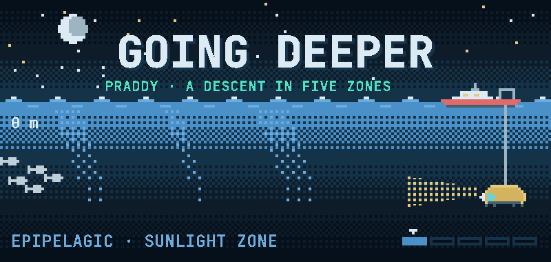</a>

<h3 align="center">Welcome aboard, I'm Praddy</h3>

  <i>Curious by default. I follow questions down into data, physics and AI, and come back up with small, private, open-source tools.</i>

I'm a data science and materials science student who picked up programming as a hobby. I build open-source,
privacy-focused tools that use as little compute as they can, and I'm drawn to AI architecture, computing, physics
and scientific research.

**Currently exploring:** local AI architecture (how capable models can run on modest hardware, and how the pieces fit
together) and computational physics, like simulating small quantum systems.

 

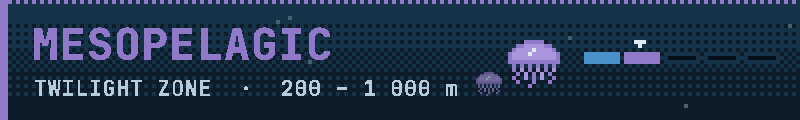

### Principles

<table>
  <tr>
    <td width="72" align="center"></td>
    <td><b>Curiosity first.</b> Every answer here started as a question I couldn't leave alone.</td>
  </tr>
  <tr>
    <td align="center"></td>
    <td><b>Your data stays yours.</b> My tools run on your machine, and nothing leaves it unless you ask.</td>
  </tr>
  <tr>
    <td align="center">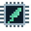</td>
    <td><b>Small footprint.</b> Software should respect modest hardware: little memory, little compute, quick to start.</td>
  </tr>
  <tr>
    <td align="center"></td>
    <td><b>Open by default.</b> The code is public, so anyone can read it, fix it or take it further.</td>
  </tr>
  <tr>
    <td align="center"></td>
    <td><b>Theory and practice.</b> Understand it properly, then make it work. Neither is enough on its own.</td>
  </tr>
  <tr>
    <td align="center"></td>
    <td><b>Measure, don't guess.</b> A number is checked against its source before I trust it.</td>
  </tr>
  <tr>
    <td align="center"></td>
    <td><b>Plain words.</b> If I can't explain it simply, I don't understand it yet. Docs are part of the build.</td>
  </tr>
</table>

### Toolkit

**Languages** 

**Platform** 

**Science and data** 

**Exploring** 

 

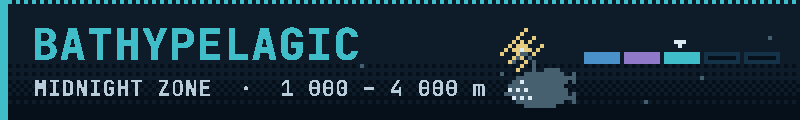

### Projects

<table>
  <tr>
    <td width="120" align="center">
      <a href="https://github.com/praddy-31/Palette">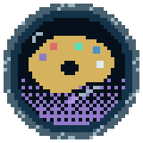</a>
    </td>
    <td>
      <a href="https://github.com/praddy-31/Palette"><b>Palette</b></a> &nbsp;<code>v1.2.0</code> 
      One command, one hotkey or one click restyles your whole Mac desktop from a single palette file. 
      Inspired by Omarchy, so you never touch individual app configs again. Open source, with a menu-bar app and a command-line tool.
    </td>
  </tr>
  <tr>
    <td align="center">
      <a href="https://github.com/praddy-31/EasyPlots">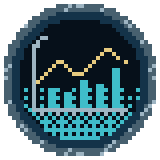</a>
    </td>
    <td>
      <a href="https://github.com/praddy-31/EasyPlots"><b>EasyPlots</b></a> &nbsp;<code>v0.1.0</code> 
      Press a hotkey, type a line, get a publication-quality plot as PNG, PDF or SVG. 
      Good plots usually mean paid software or code that takes time to write. Exploring an idea should be quick.
    </td>
  </tr>
  <tr>
    <td align="center">
      
    </td>
    <td>
      <a href="https://github.com/praddy-31/chess-review"><b>Chess Review</b></a> &nbsp;<code>v3.0.0</code> 
      A private, local stand-in for chess.com's Game Review, for macOS, Windows and Linux. 
      It analyses your games on your own computer with Stockfish and builds training from your own mistakes.
    </td>
  </tr>
</table>

 

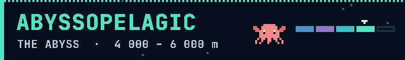

### Sonar

  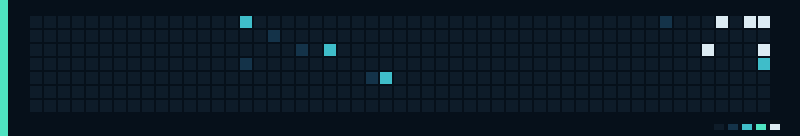

  

### Dive log

- **Palette** `v1.2.0`: released
- **EasyPlots** `v0.1.0`: released
- **Chess Review** `v3.0.0`: released for macOS, Windows and Linux

 

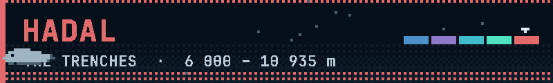

### Send a signal up

  <a href="mailto:pradhyun31@gmail.com">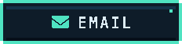</a>
  &nbsp;
  

### Crew

Thanks to <a href="https://stockfishchess.org">Stockfish</a>, <a href="https://github.com/niklasf/python-chess">python-chess</a>,
<a href="https://maiachess.com">Maia</a> and <a href="https://lczero.org">lc0</a>, <a href="https://tauri.app">Tauri</a>,
<a href="https://omarchy.org">Omarchy</a> (the inspiration for Palette), Rex (whose Abyssal Trench theme colours this page),
<a href="https://www.jetbrains.com/lp/mono/">JetBrains Mono</a> and <a href="https://www.nerdfonts.com">Nerd Fonts</a>.

  

<a href="#surface">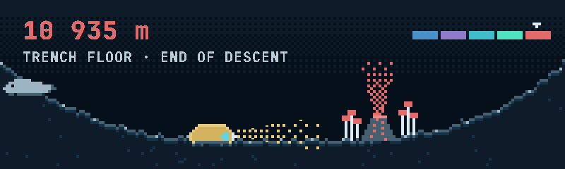</a>

Something glows on the trench floor…

 

<i>You found the trench floor. Most of what I build started as "I wonder if..."</i>

Go deeper?

<i>There is no deeper. 10 935 m is the bottom of the ocean.</i>

Okay, one more.

<i>The pressure here is about 1 086 bar, a thousand times the surface. Only curiosity made it this far.</i>

